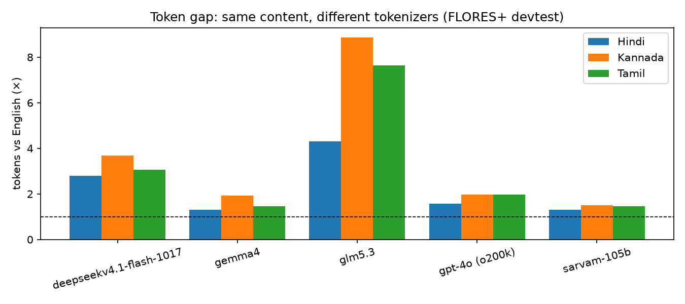
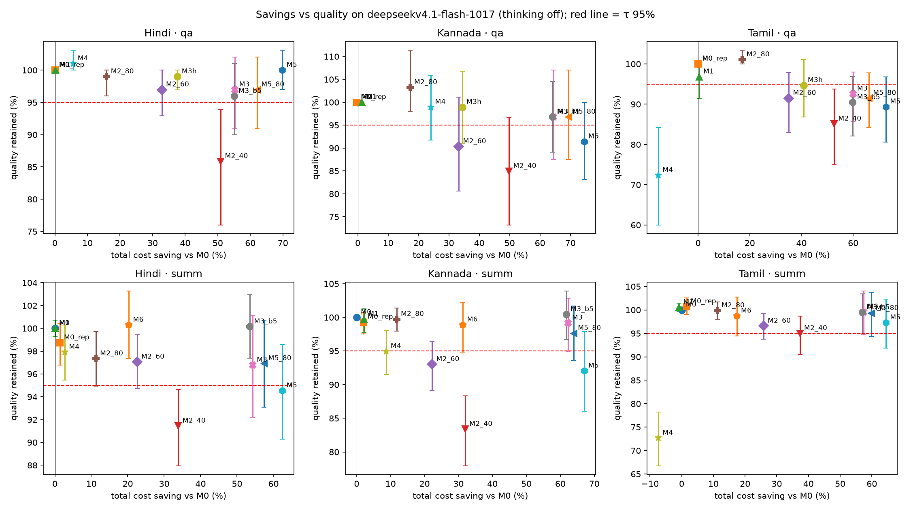

# Indic Prompt Compressor

A layer that sits between an application and an LLM. It makes **Hindi, Kannada and Tamil** prompts cheaper to send, and keeps answer quality at **≥ 95% of the original prompt's quality** (τ = 0.95).

Most LLM tokenizers are built mainly for English. They split Indic scripts into many more tokens, so the same content costs 3–9× more to send. This project:
1. **measures** that gap for each model's tokenizer;
2. **tests** ten ways to close it on real QA and summarisation data, with an automatic judge;
3. **ships** the methods that passed as a small app: a rule-based router, a FastAPI backend and a one-page web UI.

> **Headline:** at τ = 95%, the best method per language × task saves **58% of the ₹ cost on DeepSeek V4.1 Flash**. On GLM-5.3, whose tokenizer is worst at Indic, the projected saving is **73%** (78% if the borderline Tamil QA method is used). Under the strict test (the lower bound of the 95% confidence interval must also be ≥ τ), the savings are 51% and 64%.

---

## Contents
1. [The problem: the token tax](#1-the-problem-the-token-tax)
2. [Quick start](#2-quick-start)
3. [Experiment design](#3-experiment-design)
4. [The methods](#4-the-methods)
5. [Results](#5-results)
6. [The four runs: what changed and why](#6-the-four-runs-what-changed-and-why)
7. [What didn't work](#7-what-didnt-work)
8. [Reproducibility and noise](#8-reproducibility-and-noise)
9. [The app: compressor layer, router, API, UI](#9-the-app-compressor-layer-router-api-ui)
10. [Caveats and limitations](#10-caveats-and-limitations)
11. [Next steps](#11-next-steps)
12. [Repository layout](#12-repository-layout)
13. [Presentation](#13-presentation)
14. [Sources](#14-sources)

---

## 1. The problem: the token tax

**Parity** is tokens(Indic) / tokens(English) for the same content. The measurements below use **FLORES+ devtest**, about 1,000 parallel sentences. **Fertility** is tokens per word.

| Tokenizer | Hindi | Kannada | Tamil | Fertility hi / kn / ta |
|---|---|---|---|---|
| **GLM-5.3** (`glm5.3`, `glm5.3-flash`) | **4.31×** | **8.85×** | **7.64×** | 4.57 / 14.95 / 12.39 |
| **DeepSeek V4.1 Flash** | 2.79× | 3.69× | 3.07× | 2.95 / 6.19 / 4.95 |
| GPT-4o (o200k, reference) | 1.57× | 1.97× | 1.98× | 1.65 / 3.29 / 3.17 |
| Gemma 4 | 1.31× | 1.92× | 1.47× | 1.39 / 3.24 / 2.37 |
| Sarvam-105B | 1.31× | 1.51× | 1.47× | 1.39 / 2.54 / 2.37 |

Average tokens per FLORES sentence on GLM-5.3: English 26.9, Hindi 115.9, Tamil 205.3, **Kannada 237.8**.



What this shows:
- **Kannada is the most expensive language on every tokenizer.** On GLM it costs about 9× English.
- **The gap depends on the tokenizer, not only on the language.** Sarvam and Gemma are already close to English (1.3–1.9×), so there is little to save there.
- A method that helps one tokenizer can hurt another. Romanisation is an example (§7). This is why **the router takes the target model as an input**.

**Prices used** (₹ per 1M tokens, input / output): DeepSeek V4.1 Flash 25 / 105 · GLM-5.3 126 / 390 · GLM-5.3 Flash 13.5 / 45 · Sarvam-105B 15 / 60 · Gemma 4 35 / 90.

---

## 2. Quick start

```bash
# one-time setup
uv sync                                    # Python 3.12 venv + all deps (IndicTransToolkit needs gcc)
cp .env.example .env                       # fill SARVAM_API_KEY and HF_TOKEN
uv run python scripts/download_assets.py   # ~3 GB: FLORES+, IndicQA, tokenizers, IndicTrans2, LLMLingua-2, LaBSE
```
Accept the terms on these gated Hugging Face pages, using the same account as `HF_TOKEN`:
[flores_plus](https://huggingface.co/datasets/openlanguagedata/flores_plus) ·
[indictrans2-indic-en-dist-200M](https://huggingface.co/ai4bharat/indictrans2-indic-en-dist-200M) ·
[indictrans2-en-indic-dist-200M](https://huggingface.co/ai4bharat/indictrans2-en-indic-dist-200M).

Optional: `uv run python scripts/download_assets.py --ollama` adds the sarvam-translate GGUF for method M3b. It needs `ollama serve` running.

**Run the experiment notebook**
```bash
uv run jupyter lab notebooks/01_deepseek_experiment.ipynb
```
Set `SMOKE = True` first (5 items per cell), then `SMOKE = False` for the full run (50 per cell). API responses are cached in `cache/api/`, so re-running is free.

**Run the app**
```bash
uv run uvicorn icomp.server:app --port 8000      # open http://localhost:8000
uv run pytest icomp/tests -q                      # router / text tests (no GPU, no API)
curl localhost:8000/api/health                    # key found? which local models are loaded?
```
Details are in [§9](#9-the-app-compressor-layer-router-api-ui).

---

## 3. Experiment design

| Item | Choice |
|---|---|
| Target model | `deepseekv4.1-flash-1017`, **thinking off** (`reasoning_effort: "none"`), temperature 0, called through the Sarvam API |
| Judge | `sarvam-105b`, thinking off. It is Indic-native and from a different family than the target |
| Languages × tasks | Hindi, Kannada, Tamil × QA and summarisation = **6 cells** |
| Items | **50 per cell**, frozen sample (seed 42) from **IndicQA** (AI4Bharat Wikipedia paragraphs). QA items have short gold answers; summarisation uses separate paragraphs with no reference summary |
| Quality bar | **τ = 0.95** of the original prompt's judge score |
| Scale (Run 4) | 3,600 target calls + 3,600 judge calls. 0 API errors, 0 missing verdicts, 0 truncated answers. Total spend about **₹94** |
| Hardware | All local models (translation, pruning, embeddings) run on an RTX 3050 Ti laptop GPU (4 GB). Their ₹ cost is zero |

### Prompts (identical for every method; only the text inside changes)
- **QA system prompt:** "Answer the question using only the given context. Give a short answer of a few words, taken from the context where possible. Output only the answer." This is followed by the language rule.
- **Summary system prompt:** "Summarise the given text in 2-3 sentences. Output only the summary." This is followed by the language rule.
- **Language rule:** "Respond only in Hindi/Kannada/Tamil, using the … script". The English-route methods use "Respond only in English" instead.

### How cost and quality are measured
- **Cost:** prompt and completion tokens come from the API `usage` field and are priced at DeepSeek rates.
  - *₹ saving* = 1 − cost(method) / cost(M0), summed over the 50 items of a cell.
  - *GLM-5.3 projected* = the same prompts counted offline with the GLM-5.3 tokenizer and priced at GLM-5.3 rates. Only the tokenizer saving is measured here; quality on GLM has not been tested.
- **Quality:** `sarvam-105b` judges every final answer against the **original Indic paragraph**, without knowing which method produced it.
  - **QA:** verdicts correct / partial / wrong score 1 / 0.5 / 0, judged against the gold answer.
  - **Summaries:** faithfulness + coverage + fluency, each scored 1–5, then divided by 15.
- **Retained** = mean judge score(method) / mean judge score(M0) on the same 50 items. The 95% CI comes from a paired bootstrap over items with 2,000 resamples.
  - **Pass** = retained ≥ 0.95.
  - **Strict pass** = the lower bound of the 95% confidence interval (CI) is also ≥ 0.95.
- **Supporting metrics:** token-F1 against the gold answer (QA), LaBSE similarity to the M0 answer, and local processing time in seconds.

### Judge checks
- **Thinking off is required.** In Run 1 the judge thought too long and returned nothing for 26% of answers (§6).
- **Gold anchoring (QA):** the judge was compared with token-F1 against gold, counting F1 ≥ 0.5 as correct.

  | Language | n | Agreement | Cohen's κ | Judge says correct | F1 says correct |
  |---|---|---|---|---|---|
  | Hindi | 350 | 0.92 | 0.21 | 0.99 | 0.91 |
  | Kannada | 350 | 0.87 | 0.38 | 0.95 | 0.83 |
  | Tamil | 350 | 0.82 | 0.41 | 0.89 | 0.75 |

  Agreement is high and κ is low-to-moderate. The judge is more lenient than strict F1, which is expected: F1 penalises correct paraphrases.
- **Hindi human spot-check:** 30 blind rows in `results/01_deepseek/hindi_spotcheck.csv`, scored with notebook cell 45. **Still pending.**

---

## 4. The methods

Each method changes **what text is sent to the LLM**, **which language the LLM answers in**, or both. The user always gets the final answer in their own language. Every local step is free (₹0) and runs on the GPU.

| ID | Name | What is sent to the LLM | LLM answers in | Post-processing | Tool |
|---|---|---|---|---|---|
| **M0** | Original | the Indic paragraph and question, unchanged | Indic | — | — |
| **M0_rep** | Original, sent again | the exact M0 request a second time (noise check) | Indic | — | — |
| **M1** | Clean-up | Unicode NFC, zero-width characters removed, `[12]` citation marks removed, whitespace tidied, exact duplicate sentences removed | Indic | — | regex |
| **M2_80 / 60 / 40** | Prune in the original script | the M1 text with less important tokens deleted, keeping 80 / 60 / 40% of them. The question is never pruned, and `। . ? \n` are always kept | Indic | — | LLMLingua-2 (XLM-RoBERTa-large) |
| **M3** | Via English | context and question translated to English sentence by sentence (beam 2) | English | answer translated back | IndicTrans2 dist-200M |
| **M3_b5** | Via English, beam 5 | like M3, with beam search 5 in both directions | English | back-translated (beam 5) | IndicTrans2 |
| **M3h** | Hybrid (QA only) | beam-5 English context + the 2 original-script sentences most similar to the question (picked with LaBSE) + the original question. The model is told to copy names and numbers from the original sentences | **Indic** (directly) | — | IndicTrans2 + LaBSE |
| **M4** | Romanise | text in Roman letters (ITRANS), with a note "(The text below is Hindi written in Roman letters.)" | Indic script | — | `indic_transliteration` |
| **M5** | English, then prune 60% | M3, then LLMLingua-2 keeps 60% of the English context. The question is kept whole | English | back-translated | IndicTrans2 + LLMLingua-2 |
| **M5_80** | English, then prune 80% | like M5, keeping 80% | English | back-translated | IndicTrans2 + LLMLingua-2 |
| **M6** | Answer in English (summaries) | the M1 Indic text, unchanged | English | summary translated back | IndicTrans2 en→indic |

What each method targets:
- **M0 / M0_rep** give the reference and the noise floor. If two identical requests already differ by X%, a quality drop smaller than X% is not real.
- **M1** is the free, lossless baseline. It saves about 0% on clean Wikipedia text; it is meant for messy real-world prompts.
- **M2** shortens the *input* without leaving the language. It is cheap, but it can cut into meaning-carrying parts of Kannada and Tamil words, which pack a lot into each word.
- **M3** attacks the *tokenizer gap* itself. English is 2.8–3.7× cheaper on DeepSeek and 4–9× cheaper on GLM. It also shortens the *output*, because English answers are shorter and the back-translation runs locally for free. The risk is translation errors.
- **M3_b5 / M3h** were added in Run 4 to fix Tamil translation errors, for example "cancer" translated as "psoriasis".
- **M4** tests whether the gap comes from the *script* rather than the language.
- **M5 / M5_80** combine translation and pruning for the largest saving.
- **M6** saves on the output only, for long answers. The model reads the original text exactly and writes its summary in cheaper English.

Defined in the notebook but **not run**: **M3b** (via English with sarvam-translate 4B GGUF in Ollama) and **M4b** (Sarvam `/transliterate` API). The paid Sarvam `/translate` API costs ₹2 per 1,000 characters. That is far more than the input it would save (about ₹0.01–0.07 per 1,000 Hindi characters), so translation has to run locally to save money.

---

## 5. Results

All numbers in this section are from **Run 4** (final, n = 50 per cell). The data is in `results/01_deepseek/`: `summary.csv` has one row per cell × method, and `results.jsonl` has every answer with its judge verdict and cost.

### 5.1 Savings vs quality, all methods

Each cell shows **₹ saving / quality retained**. ✓ = passes τ on the mean; **bold** = fails.

| Method | Hindi QA | Hindi summ | Kannada QA | Kannada summ | Tamil QA | Tamil summ | Passes |
|---|---|---|---|---|---|---|---|
| M1 | 0% / 1.00 ✓ | 0% / 1.00 ✓ | 2% / 1.00 ✓ | 2% / 1.00 ✓ | 0% / 0.97 ✓ | −1% / 1.01 ✓ | 6/6 |
| M2_80 | 16% / 0.99 ✓ | 11% / 0.97 ✓ | 17% / 1.03 ✓ | 12% / 1.00 ✓ | 17% / 1.01 ✓ | 11% / 1.00 ✓ | **6/6** |
| M2_60 | 33% / 0.97 ✓ | 23% / 0.97 ✓ | 33% / **0.90** | 22% / **0.93** | 35% / **0.92** | 26% / 0.97 ✓ | 3/6 |
| M2_40 | 51% / **0.86** | 34% / **0.91** | 50% / **0.85** | 32% / **0.83** | 53% / **0.85** | 37% / **0.950−** | 0/6 |
| M3 | 55% / 0.97 ✓ | 54% / 0.97 ✓ | 64% / 0.97 ✓ | 62% / 0.99 ✓ | 60% / **0.93** | 57% / 1.00 ✓ | 5/6 |
| M3_b5 | 55% / 0.96 ✓ | 54% / 1.00 ✓ | 64% / 0.97 ✓ | 62% / 1.00 ✓ | 60% / **0.90** | 57% / 0.99 ✓ | 5/6 |
| M3h | 38% / 0.99 ✓ | — | 34% / 0.99 ✓ | — | 41% / **0.947** | — | 2/3 |
| M4 | 6% / 1.01 ✓ | 3% / 0.98 ✓ | 24% / 0.99 ✓ | 9% / **0.950−** | **−15%** / **0.72** | **−7%** / **0.73** | 3/6 |
| M5 | **70% / 1.00** ✓ | 62% / **0.945** | 75% / **0.91** | 67% / **0.92** | 73% / **0.89** | 64% / 0.97 ✓ | 2/6 |
| M5_80 | 62% / 0.97 ✓ | 57% / 0.97 ✓ | 69% / 0.97 ✓ | 64% / 0.98 ✓ | 66% / **0.92** | 60% / 0.99 ✓ | **5/6** |
| M6 | — | 20% / 1.00 ✓ | — | 31% / 0.99 ✓ | — | 17% / 0.99 ✓ | 3/3 |

"0.950−" means just under 0.95 before rounding.

**Average ₹ saving per method across all its cells** (cost-weighted):

| Method | M5 | M5_80 | M3 | M3_b5 | M2_40 | M3h | M2_60 | M6 | M2_80 | M4 | M1 |
|---|---|---|---|---|---|---|---|---|---|---|---|
| ₹ saving | 67.0% | 62.0% | 58.3% | 57.9% | 40.1% | 37.8% | 27.0% | 22.5% | 13.2% | 1.8% | 0.5% |
| Passes τ | 2/6 | 5/6 | 5/6 | 5/6 | 0/6 | 2/3 | 3/6 | 3/3 | 6/6 | 3/6 | 6/6 |



### 5.2 Best method per cell (the policy the app uses)

| Cell | Best on mean (balanced) | ₹ saving | Strict, CI lower bound ≥ τ (safe) | ₹ saving | GLM-5.3 projected (balanced) |
|---|---|---|---|---|---|
| Hindi QA | M5 | 70% | M5 | 70% | 81% |
| Hindi summ | M5_80 | 57% | M3_b5 | 54% | 73% |
| Kannada QA | M5_80 | 69% | M2_80 | 17% | 87% |
| Kannada summ | M5_80 | 64% | M3_b5 | 62% | 85% |
| Tamil QA | M2_80 (M3h 41% at 0.947, borderline) | 17% (41%) | M2_80 | 17% | 19% (64%) |
| Tamil summ | M5 | 64% | M3_b5 | 57% | 86% |
| **Total ₹ saving** | | **58% DeepSeek** | | **51%** | **73%** (78% with M3h for Tamil QA) |

### 5.3 Main findings
1. **Translating to English is the strongest single idea.** M3 saves 54–64% on DeepSeek and passes in 5 of 6 cells. It also cuts *output* tokens by 50–65%, because English answers are shorter and back-translation is free.
2. **M5_80 is the best English-route method overall.** It saves about 5 points more than M3 at the same quality: 5 of 6 cells pass at 57–69% saving. It rescued Kannada QA (M5 0.91 → 0.97) and the Hindi and Kannada summaries.
3. **Pruning 60% of the English text (M5) is the cheapest method but drops facts.** For example "52.52%" became "32%", and specific names were replaced by vaguer ones. It is safe only for Hindi QA and Tamil summaries.
4. **Beam 5 helps summaries, not QA.** Hindi and Kannada summaries reach about 1.00 with a CI lower bound of at least 0.97, so they pass even the strict test. It doubles translation time (1.6–4.2 s per item).
5. **Pruning in the original script is safe only when gentle.** Keeping 80% passes everywhere but saves only 11–17%. Keeping 60% fails for Kannada and Tamil QA. Keeping 40% fails everywhere. **Kannada and Tamil tolerate pruning less than Hindi.**
6. **M6 (answer in English) is a nearly free 17–31% saving on summaries** with no measurable quality loss.
7. **Summary trade-off:** via-English summaries score *higher* on coverage than M0 (Kannada 4.80 vs 4.42) and slightly *lower* on faithfulness (about 4.6–4.8 vs 4.9–5.0). Translation noise introduces small factual slips.

### 5.4 Tamil QA: the hardest cell
No English-route method passes clearly. M3 0.93, M3_b5 0.90, M5_80 0.92, M5 0.89. The failures are **IndicTrans2 translation errors, not LLM errors**:
- புற்றுநோய் (cancer) → "Psoriasis". Beam 2 got this right in Run 4, but beam 5 got it wrong, so the errors just move around.
- "R. K. Narayan" → "K. Narayanan"; சைன் → "Jaya".
- Answers that are in the text get lost: "Not mentioned in the context".

**M3h (hybrid)** fixed 4 of these items (names such as Mancherial and R. K. Narayan, and both "not mentioned" cases). It broke 4 others: the 2 selected sentences didn't contain the answer, so the model answered from the wrong one ("Asaf Jah" instead of "Aurangzeb"), or the judge marked a shorter answer as partial ("Western Ganga" without "dynasty"). The result is 0.947 at 41% saving, just under τ and within the noise. Answers copy the original wording, so token-F1 rises (Tamil 0.67 → 0.73, Hindi 0.73 → 0.85).

The methods fail on different items. M3h fixes items M3 gets wrong and vice versa (Tamil 4 fixed / 4 broken, Kannada 5 / 3). A per-item router could exploit this ([§11](#11-next-steps)).

### 5.5 Full Run 4 tables

<details>
<summary><b>A1. All metrics per cell</b> (tokens per item, savings %, judge score, CI, F1, LaBSE similarity, local seconds)</summary>

**Hindi · QA**

| Method | in tok | out tok | in save % | out save % | ₹ save % | GLM proj % | judge | retained [95% CI] | pass mean / CI | F1 | sim to M0 | local s |
|---|---|---|---|---|---|---|---|---|---|---|---|---|
| M0 | 1079 | 11 | 0.0 | 0.0 | 0.0 | 0.0 | 0.990 | 1.000 [1.00–1.00] | ✓ / ✓ | 0.899 | 1.000 | 0.00 |
| M0_rep | 1079 | 11 | 0.0 | 0.0 | 0.0 | 0.0 | 0.990 | 1.000 [1.00–1.00] | ✓ / ✓ | 0.899 | 1.000 | 0.00 |
| M1 | 1077 | 11 | 0.2 | 0.0 | 0.2 | 0.1 | 0.990 | 1.000 [1.00–1.00] | ✓ / ✓ | 0.899 | 1.000 | 0.00 |
| M2_40 | 510 | 10 | 52.7 | 7.4 | 50.9 | 54.9 | 0.850 | 0.859 [0.76–0.94] | ✗ / ✗ | 0.755 | 0.822 | 0.16 |
| M2_60 | 712 | 10 | 34.0 | 4.2 | 32.8 | 36.1 | 0.960 | 0.970 [0.93–1.00] | ✓ / ✗ | 0.872 | 0.934 | 0.14 |
| M2_80 | 901 | 10 | 16.5 | 1.5 | 15.9 | 17.5 | 0.980 | 0.990 [0.96–1.00] | ✓ / ✓ | 0.878 | 0.950 | 0.14 |
| M3 | 480 | 5 | 55.6 | 49.1 | 55.3 | 71.1 | 0.960 | 0.970 [0.91–1.02] | ✓ / ✗ | 0.728 | 0.885 | 1.57 |
| M3_b5 | 482 | 5 | 55.4 | 48.9 | 55.1 | 70.9 | 0.950 | 0.960 [0.90–1.01] | ✓ / ✗ | 0.726 | 0.881 | 2.96 |
| M3h | 653 | 11 | 39.4 | -5.7 | 37.7 | 54.1 | 0.980 | 0.990 [0.97–1.00] | ✓ / ✓ | 0.845 | 0.933 | 3.01 |
| M4 | 1014 | 11 | 6.0 | -1.3 | 5.7 | 38.6 | 1.000 | 1.010 [1.00–1.03] | ✓ / ✓ | 0.777 | 0.935 | 0.00 |
| M5 | 316 | 5 | 70.7 | 50.0 | 69.9 | 80.7 | 0.990 | 1.000 [0.97–1.03] | ✓ / ✓ | 0.735 | 0.880 | 1.69 |
| M5_80 | 403 | 5 | 62.6 | 49.1 | 62.1 | 75.5 | 0.960 | 0.970 [0.91–1.02] | ✓ / ✗ | 0.724 | 0.885 | 1.69 |

**Hindi · summarisation**

| Method | in tok | out tok | in save % | out save % | ₹ save % | GLM proj % | judge | retained [95% CI] | pass mean / CI | sim to M0 | local s |
|---|---|---|---|---|---|---|---|---|---|---|---|
| M0 | 1217 | 213 | 0.0 | 0.0 | 0.0 | 0.0 | 0.951 | 1.000 [1.00–1.00] | ✓ / ✓ | 1.000 | 0.00 |
| M0_rep | 1217 | 206 | 0.0 | 3.2 | 1.3 | 1.1 | 0.939 | 0.987 [0.97–1.00] | ✓ / ✓ | 0.948 | 0.00 |
| M1 | 1215 | 213 | 0.2 | -0.1 | 0.1 | 0.1 | 0.951 | 1.000 [0.99–1.01] | ✓ / ✓ | 0.987 | 0.00 |
| M2_40 | 542 | 203 | 55.5 | 4.4 | 33.9 | 39.6 | 0.869 | 0.914 [0.88–0.95] | ✗ / ✗ | 0.853 | 0.23 |
| M2_60 | 781 | 203 | 35.8 | 4.5 | 22.6 | 26.6 | 0.923 | 0.971 [0.95–0.99] | ✓ / ✗ | 0.867 | 0.23 |
| M2_80 | 1008 | 206 | 17.2 | 3.1 | 11.2 | 13.3 | 0.925 | 0.973 [0.95–1.00] | ✓ / ✗ | 0.894 | 0.23 |
| M3 | 529 | 104 | 56.5 | 51.1 | 54.3 | 70.7 | 0.920 | 0.968 [0.92–1.01] | ✓ / ✗ | 0.846 | 2.15 |
| M3_b5 | 530 | 107 | 56.4 | 49.6 | 53.5 | 70.3 | 0.952 | 1.001 [0.97–1.03] | ✓ / ✓ | 0.850 | 4.17 |
| M4 | 1134 | 219 | 6.8 | -2.9 | 2.7 | 24.9 | 0.931 | 0.979 [0.95–1.00] | ✓ / ✓ | 0.861 | 0.00 |
| M5 | 332 | 110 | 72.7 | 48.5 | 62.5 | 76.9 | 0.899 | 0.945 [0.90–0.99] | ✗ / ✗ | 0.837 | 2.37 |
| M5_80 | 437 | 110 | 64.1 | 48.3 | 57.4 | 73.2 | 0.921 | 0.969 [0.93–1.01] | ✓ / ✗ | 0.849 | 2.42 |
| M6 | 1207 | 113 | 0.8 | 46.8 | 20.3 | 23.8 | 0.953 | 1.003 [0.97–1.03] | ✓ / ✓ | 0.846 | 0.40 |

**Kannada · QA**

| Method | in tok | out tok | in save % | out save % | ₹ save % | GLM proj % | judge | retained [95% CI] | pass mean / CI | F1 | sim to M0 | local s |
|---|---|---|---|---|---|---|---|---|---|---|---|---|
| M0 | 760 | 15 | 0.0 | 0.0 | 0.0 | 0.0 | 0.930 | 1.000 [1.00–1.00] | ✓ / ✓ | 0.789 | 1.000 | 0.00 |
| M0_rep | 760 | 16 | 0.0 | -4.7 | -0.4 | -0.2 | 0.930 | 1.000 [1.00–1.00] | ✓ / ✓ | 0.769 | 0.966 | 0.00 |
| M1 | 750 | 15 | 1.3 | 2.8 | 1.5 | 0.4 | 0.930 | 1.000 [1.00–1.00] | ✓ / ✓ | 0.792 | 0.991 | 0.00 |
| M2_40 | 360 | 13 | 52.7 | 15.7 | 49.8 | 54.6 | 0.790 | 0.849 [0.73–0.97] | ✗ / ✗ | 0.643 | 0.738 | 0.11 |
| M2_60 | 489 | 14 | 35.6 | 5.4 | 33.3 | 36.3 | 0.840 | 0.903 [0.81–1.01] | ✗ / ✗ | 0.704 | 0.815 | 0.11 |
| M2_80 | 623 | 14 | 18.0 | 7.9 | 17.2 | 18.2 | 0.960 | 1.032 [0.98–1.11] | ✓ / ✓ | 0.814 | 0.923 | 0.11 |
| M3 | 269 | 6 | 64.6 | 63.3 | 64.5 | 84.4 | 0.900 | 0.968 [0.88–1.07] | ✓ / ✗ | 0.633 | 0.835 | 0.83 |
| M3_b5 | 271 | 6 | 64.4 | 62.1 | 64.2 | 84.3 | 0.900 | 0.968 [0.89–1.05] | ✓ / ✗ | 0.632 | 0.831 | 1.61 |
| M3h | 474 | 16 | 37.6 | -3.4 | 34.4 | 54.3 | 0.920 | 0.989 [0.91–1.07] | ✓ / ✗ | 0.743 | 0.871 | 1.62 |
| M4 | 567 | 14 | 25.3 | 9.1 | 24.1 | 64.0 | 0.920 | 0.989 [0.92–1.06] | ✓ / ✗ | 0.653 | 0.861 | 0.00 |
| M5 | 186 | 6 | 75.5 | 63.2 | 74.5 | 89.0 | 0.850 | 0.914 [0.83–1.00] | ✗ / ✗ | 0.606 | 0.792 | 0.94 |
| M5_80 | 231 | 5 | 69.7 | 65.6 | 69.3 | 86.6 | 0.900 | 0.968 [0.88–1.07] | ✓ / ✗ | 0.637 | 0.839 | 0.93 |

**Kannada · summarisation**

| Method | in tok | out tok | in save % | out save % | ₹ save % | GLM proj % | judge | retained [95% CI] | pass mean / CI | sim to M0 | local s |
|---|---|---|---|---|---|---|---|---|---|---|---|
| M0 | 770 | 227 | 0.0 | 0.0 | 0.0 | 0.0 | 0.955 | 1.000 [1.00–1.00] | ✓ / ✓ | 1.000 | 0.00 |
| M0_rep | 770 | 219 | 0.0 | 3.6 | 2.0 | 2.0 | 0.948 | 0.993 [0.98–1.01] | ✓ / ✓ | 0.953 | 0.00 |
| M1 | 761 | 220 | 1.2 | 2.9 | 2.2 | 1.5 | 0.952 | 0.997 [0.98–1.01] | ✓ / ✓ | 0.949 | 0.00 |
| M2_40 | 332 | 200 | 56.8 | 11.9 | 32.0 | 37.3 | 0.796 | 0.834 [0.78–0.88] | ✗ / ✗ | 0.814 | 0.15 |
| M2_60 | 475 | 206 | 38.3 | 9.3 | 22.2 | 25.5 | 0.888 | 0.930 [0.89–0.96] | ✗ / ✗ | 0.856 | 0.15 |
| M2_80 | 621 | 214 | 19.3 | 5.7 | 11.8 | 13.0 | 0.952 | 0.997 [0.98–1.01] | ✓ / ✓ | 0.898 | 0.15 |
| M3 | 255 | 94 | 66.9 | 58.5 | 62.2 | 84.0 | 0.947 | 0.992 [0.95–1.03] | ✓ / ✗ | 0.824 | 1.20 |
| M3_b5 | 256 | 96 | 66.8 | 57.8 | 61.8 | 83.8 | 0.959 | 1.004 [0.97–1.04] | ✓ / ✓ | 0.834 | 2.36 |
| M4 | 575 | 237 | 25.3 | -4.5 | 8.8 | 32.6 | 0.907 | 0.950 [0.92–0.98] | ✗ / ✗ | 0.861 | 0.00 |
| M5 | 167 | 96 | 78.3 | 57.9 | 67.0 | 86.5 | 0.879 | 0.920 [0.86–0.98] | ✗ / ✗ | 0.833 | 1.34 |
| M5_80 | 214 | 97 | 72.2 | 57.3 | 63.9 | 84.9 | 0.932 | 0.976 [0.94–1.02] | ✓ / ✗ | 0.824 | 1.36 |
| M6 | 754 | 102 | 2.1 | 54.9 | 31.3 | 39.7 | 0.944 | 0.989 [0.95–1.02] | ✓ / ✗ | 0.829 | 0.38 |

**Tamil · QA**

| Method | in tok | out tok | in save % | out save % | ₹ save % | GLM proj % | judge | retained [95% CI] | pass mean / CI | F1 | sim to M0 | local s |
|---|---|---|---|---|---|---|---|---|---|---|---|---|
| M0 | 975 | 11 | 0.0 | 0.0 | 0.0 | 0.0 | 0.940 | 1.000 [1.00–1.00] | ✓ / ✓ | 0.763 | 1.000 | 0.00 |
| M0_rep | 975 | 11 | 0.0 | -0.2 | -0.0 | -0.0 | 0.940 | 1.000 [1.00–1.00] | ✓ / ✓ | 0.763 | 0.982 | 0.00 |
| M1 | 973 | 10 | 0.2 | 4.7 | 0.4 | 0.3 | 0.910 | 0.968 [0.91–1.00] | ✓ / ✗ | 0.755 | 0.959 | 0.00 |
| M2_40 | 446 | 9 | 54.3 | 17.8 | 52.6 | 57.3 | 0.800 | 0.851 [0.75–0.94] | ✗ / ✗ | 0.638 | 0.774 | 0.19 |
| M2_60 | 622 | 10 | 36.2 | 11.6 | 35.1 | 38.4 | 0.860 | 0.915 [0.83–0.98] | ✗ / ✗ | 0.729 | 0.871 | 0.19 |
| M2_80 | 802 | 11 | 17.8 | 2.9 | 17.1 | 18.7 | 0.950 | 1.011 [1.00–1.03] | ✓ / ✓ | 0.784 | 0.938 | 0.19 |
| M3 | 389 | 5 | 60.2 | 54.7 | 59.9 | 83.3 | 0.870 | 0.926 [0.86–0.98] | ✗ / ✗ | 0.668 | 0.857 | 1.23 |
| M3_b5 | 389 | 5 | 60.1 | 55.1 | 59.9 | 83.3 | 0.850 | 0.904 [0.82–0.97] | ✗ / ✗ | 0.650 | 0.829 | 2.38 |
| M3h | 559 | 11 | 42.7 | 2.0 | 40.8 | 64.4 | 0.890 | 0.947 [0.87–1.01] | ✗ / ✗ | 0.734 | 0.881 | 2.41 |
| M4 | 1135 | 10 | -16.3 | 5.8 | -15.3 | 47.3 | 0.680 | 0.723 [0.60–0.84] | ✗ / ✗ | 0.574 | 0.706 | 0.00 |
| M5 | 258 | 5 | 73.5 | 54.7 | 72.7 | 88.7 | 0.840 | 0.894 [0.81–0.97] | ✗ / ✗ | 0.615 | 0.800 | 1.39 |
| M5_80 | 327 | 5 | 66.4 | 58.2 | 66.1 | 85.9 | 0.860 | 0.915 [0.84–0.98] | ✗ / ✗ | 0.645 | 0.825 | 1.39 |

**Tamil · summarisation**

| Method | in tok | out tok | in save % | out save % | ₹ save % | GLM proj % | judge | retained [95% CI] | pass mean / CI | sim to M0 | local s |
|---|---|---|---|---|---|---|---|---|---|---|---|
| M0 | 1227 | 202 | 0.0 | 0.0 | 0.0 | 0.0 | 0.932 | 1.000 [1.00–1.00] | ✓ / ✓ | 1.000 | 0.00 |
| M0_rep | 1227 | 194 | 0.0 | 3.8 | 1.5 | 1.4 | 0.939 | 1.007 [0.99–1.03] | ✓ / ✓ | 0.943 | 0.00 |
| M1 | 1225 | 207 | 0.2 | -2.3 | -0.8 | -0.7 | 0.937 | 1.006 [1.00–1.01] | ✓ / ✓ | 0.968 | 0.00 |
| M2_40 | 528 | 184 | 57.0 | 8.8 | 37.3 | 43.6 | 0.885 | 0.950 [0.91–0.99] | ✗ / ✗ | 0.805 | 0.26 |
| M2_60 | 761 | 185 | 38.0 | 8.2 | 25.8 | 30.1 | 0.900 | 0.966 [0.94–0.99] | ✓ / ✗ | 0.833 | 0.26 |
| M2_80 | 1001 | 200 | 18.4 | 0.9 | 11.3 | 13.4 | 0.931 | 0.999 [0.98–1.02] | ✓ / ✓ | 0.878 | 0.26 |
| M3 | 459 | 102 | 62.6 | 49.7 | 57.4 | 82.6 | 0.928 | 0.996 [0.95–1.04] | ✓ / ✗ | 0.806 | 1.99 |
| M3_b5 | 460 | 103 | 62.5 | 49.0 | 57.0 | 82.5 | 0.927 | 0.994 [0.95–1.03] | ✓ / ✓ | 0.811 | 3.85 |
| M4 | 1435 | 189 | -16.9 | 6.5 | -7.3 | 34.6 | 0.677 | 0.727 [0.67–0.78] | ✗ / ✗ | 0.742 | 0.00 |
| M5 | 289 | 107 | 76.5 | 47.0 | 64.4 | 86.0 | 0.907 | 0.973 [0.92–1.02] | ✓ / ✗ | 0.804 | 2.21 |
| M5_80 | 380 | 108 | 69.0 | 46.6 | 59.9 | 84.0 | 0.925 | 0.993 [0.94–1.04] | ✓ / ✗ | 0.788 | 2.21 |
| M6 | 1220 | 118 | 0.6 | 41.7 | 17.4 | 25.7 | 0.920 | 0.987 [0.94–1.03] | ✓ / ✗ | 0.806 | 0.49 |

</details>

<details>
<summary><b>A2. QA verdict counts</b> (correct / partial / wrong, out of 50)</summary>

| Method | Hindi | Kannada | Tamil |
|---|---|---|---|
| M0 | 49 / 1 / 0 | 45 / 3 / 2 | 46 / 2 / 2 |
| M0_rep | 49 / 1 / 0 | 45 / 3 / 2 | 46 / 2 / 2 |
| M1 | 49 / 1 / 0 | 45 / 3 / 2 | 44 / 3 / 3 |
| M2_40 | 39 / 7 / 4 | 34 / 11 / 5 | 39 / 2 / 9 |
| M2_60 | 46 / 4 / 0 | 37 / 10 / 3 | 42 / 2 / 6 |
| M2_80 | 48 / 2 / 0 | 46 / 4 / 0 | 47 / 1 / 2 |
| M3 | 47 / 2 / 1 | 42 / 6 / 2 | 43 / 1 / 6 |
| M3_b5 | 46 / 3 / 1 | 42 / 6 / 2 | 42 / 1 / 7 |
| M3h | 48 / 2 / 0 | 44 / 4 / 2 | 43 / 3 / 4 |
| M4 | 50 / 0 / 0 | 44 / 4 / 2 | 32 / 4 / 14 |
| M5 | 49 / 1 / 0 | 39 / 7 / 4 | 41 / 2 / 7 |
| M5_80 | 47 / 2 / 1 | 42 / 6 / 2 | 42 / 2 / 6 |

</details>

<details>
<summary><b>A3. Summary judge sub-scores</b> (1–5: faithfulness / coverage / fluency)</summary>

| Method | Hindi | Kannada | Tamil |
|---|---|---|---|
| M0 | 4.92 / 4.34 / 5.00 | 4.90 / 4.42 / 5.00 | 4.98 / 4.00 / 5.00 |
| M0_rep | 4.84 / 4.26 / 4.98 | 4.84 / 4.38 / 5.00 | 4.98 / 4.10 / 5.00 |
| M1 | 4.90 / 4.36 / 5.00 | 4.86 / 4.42 / 5.00 | 4.98 / 4.08 / 5.00 |
| M2_40 | 4.40 / 3.74 / 4.90 | 3.84 / 3.48 / 4.62 | 4.62 / 3.78 / 4.88 |
| M2_60 | 4.80 / 4.08 / 4.96 | 4.44 / 4.00 / 4.88 | 4.74 / 3.80 / 4.96 |
| M2_80 | 4.88 / 4.04 / 4.96 | 4.88 / 4.40 / 5.00 | 4.96 / 4.00 / 5.00 |
| M3 | 4.58 / 4.44 / 4.78 | 4.68 / 4.68 / 4.84 | 4.52 / 4.52 / 4.88 |
| M3_b5 | 4.74 / 4.58 / 4.96 | 4.76 / 4.80 / 4.82 | 4.58 / 4.52 / 4.80 |
| M4 | 4.84 / 4.12 / 5.00 | 4.58 / 4.02 / 5.00 | 3.16 / 2.62 / 4.38 |
| M5 | 4.38 / 4.30 / 4.80 | 4.32 / 4.30 / 4.56 | 4.50 / 4.42 / 4.68 |
| M5_80 | 4.50 / 4.42 / 4.90 | 4.58 / 4.60 / 4.80 | 4.56 / 4.50 / 4.82 |
| M6 | 4.76 / 4.58 / 4.96 | 4.64 / 4.64 / 4.88 | 4.48 / 4.42 / 4.90 |

</details>

<details>
<summary><b>A4. Offline input-token saving</b> (counted with the tokenizers, no API): DeepSeek % / GLM-5.3 %</summary>

| Method | Hindi QA | Hindi summ | Kannada QA | Kannada summ | Tamil QA | Tamil summ |
|---|---|---|---|---|---|---|
| M1 | 0 / 0 | 0 / 0 | 1 / 0 | 1 / 0 | 0 / 0 | 0 / 0 |
| M2_40 | 53 / 56 | 56 / 58 | 53 / 57 | 57 / 60 | 55 / 58 | 57 / 61 |
| M2_60 | 34 / 37 | 36 / 38 | 36 / 38 | 39 / 41 | 36 / 39 | 38 / 41 |
| M2_80 | 17 / 18 | 17 / 19 | 18 / 19 | 19 / 20 | 18 / 19 | 18 / 20 |
| M3 | 56 / 71 | 57 / 72 | 65 / 84 | 67 / 86 | 60 / 83 | 63 / 84 |
| M3_b5 | 56 / 71 | 57 / 72 | 65 / 84 | 67 / 85 | 60 / 83 | 63 / 84 |
| M3h | 40 / 56 | – | 38 / 58 | – | 43 / 66 | – |
| M4 | 6 / 40 | 7 / 40 | 26 / 67 | 25 / 67 | -16 / 48 | -17 / 49 |
| M5 | 71 / 81 | 73 / 82 | 76 / 89 | 79 / 91 | 74 / 89 | 77 / 90 |
| M5_80 | 63 / 76 | 64 / 77 | 70 / 87 | 73 / 88 | 67 / 86 | 69 / 87 |
| M6 | – | 1 / 0 | – | 2 / 1 | – | 1 / 0 |

</details>

---

## 6. The four runs: what changed and why

| # | Date | n per cell | Methods | Folder | What happened |
|---|---|---|---|---|---|
| 1 | 2026-11-07 | 5 | M0, M0_rep, M1, M2 (keep 60%), M3, M4, M5, M6 | overwritten by Run 2 | **Judge bug:** `sarvam-105b` with `reasoning_effort: "low"` still thought for more than 1,500–4,000 tokens and hit `max_tokens` before writing its JSON. 63 of 240 verdicts (26%) were empty, mostly for summaries and English-route methods, which biased the comparison. Token numbers were valid; quality numbers were **invalid** |
| 2 | 2026-11-07 | 5 | + M2 sweep (keep 40/60/80%) | `results/01_deepseek_smoke/` | Judge fixed (thinking off, plus a retry with a large budget). Valid, but only a rough indication: with n = 5, one QA item = 20 points |
| 3 | 2026-11-08 | 50 | same as Run 2 | `results/01_deepseek_v1/` | First full run: 2,850 + 2,850 calls. M3 best overall; Tamil QA failed (0.90) because of translation errors; M5 dropped facts; M4 negative |
| 4 | 2026-11-08 | 50 | + **M3_b5, M5_80, M3h** | `results/01_deepseek/` | **Final.** M5_80 became the best English-route method; beam 5 fixed summaries; M3h brought Tamil QA to 0.947 |

Other changes between runs: IndicTrans2 beams went from 5 to 2 after Run 1, which halved translation time. M6 was limited to summaries, because back-translating 2-word QA answers broke them.

**How the main methods moved across runs** (₹ saving / retained):

| Method | Run | Hindi QA | Hindi summ | Kannada QA | Kannada summ | Tamil QA | Tamil summ |
|---|---|---|---|---|---|---|---|
| M3 | 2 (n=5) | 56% / 1.00 | 57% / 1.01 | 66% / 1.00 | 59% / 1.01 | 59% / 0.89 | 60% / 0.96 |
| | 3 | 55% / 0.97 | 54% / 0.96 | 64% / 0.98 | 62% / 0.99 | 60% / 0.90 | 57% / 0.99 |
| | 4 | 55% / 0.97 | 54% / 0.97 | 64% / 0.97 | 62% / 0.99 | 60% / 0.93 | 57% / 1.00 |
| M5 | 2 (n=5) | 70% / 1.00 | 66% / 1.01 | 75% / 0.90 | 63% / 0.89 | 73% / 0.89 | 66% / 0.93 |
| | 3 | 70% / 1.00 | 62% / 0.94 | 75% / 0.92 | 67% / 0.92 | 73% / 0.91 | 64% / 0.96 |
| | 4 | 70% / 1.00 | 62% / 0.95 | 75% / 0.91 | 67% / 0.92 | 73% / 0.89 | 64% / 0.97 |
| M2_80 | 2 (n=5) | 16% / 1.00 | 13% / 0.97 | 17% / 1.00 | 3% / 1.00 | 18% / 1.00 | 14% / 1.00 |
| | 3 | 16% / 0.99 | 10% / 0.97 | 17% / 1.04 | 12% / 1.00 | 17% / 1.01 | 11% / 0.99 |
| | 4 | 16% / 0.99 | 11% / 0.97 | 17% / 1.03 | 12% / 1.00 | 17% / 1.01 | 11% / 1.00 |
| M6 | 2 (n=5) | – | 20% / 1.00 | – | 29% / 1.04 | – | 17% / 0.96 |
| | 3 | – | 19% / 1.00 | – | 31% / 0.99 | – | 18% / 0.98 |
| | 4 | – | 20% / 1.00 | – | 31% / 0.99 | – | 17% / 0.99 |

The smoke runs predicted the full-run savings well. Their quality estimates were noisier. For example, the smoke runs suggested "Hindi tolerates heavy pruning", but at n = 50 Hindi M2_40 scores only 0.86.

---

## 7. What didn't work

| Idea | Result | Why |
|---|---|---|
| **Romanisation (M4) on DeepSeek** | Hindi 6%, Kannada 9–24% saving; **Tamil costs 7–15% *more* and quality falls to 0.72** | Tamil script is ambiguous in ITRANS (க = ka/ga/ha), so the model misreads it. On GLM the tokenizer saving would be 40–67%, but GLM quality has not been tested |
| **Romanisation on Indic-aware tokenizers** | Sarvam and Gemma go from 1.3× to 2.4–3.4× (worse) | Their tokenizers already handle Indic scripts well |
| **Heavy pruning (M2_40)** | 32–53% saving, 0 of 6 cells pass | Deletes meaning-carrying pieces of words |
| **Pruning the English text by 60% (M5)** | cheapest, but passes only 2 of 6 cells | Drops numbers ("52.52%" → "32%") and specific names |
| **Beam 5 for QA** | no gain; Tamil QA got slightly worse | The translation errors move around instead of going away |
| **"Not mentioned" fallback** | triggers on 0–2 items per language; Tamil QA M3 0.93 → 0.947 | Kept in the app as a safety net, but it is not a fix |
| **M6 for QA** (Run 1) | broke short answers | Back-translating 2-word answers mangles them; now summaries only |
| **M1 clean-up** | about 0% on Wikipedia text | The text is already clean; meant for real user prompts |
| **Laya as router / judge** | not used | The model card reports weak Indic accuracy (Hindi 0.39, Tamil 0.25, Kannada not reported) and uncalibrated confidence. Simple rules over a measured table do the same job, are transparent and need no training |

---

## 8. Reproducibility and noise
- **DeepSeek at temperature 0 is not deterministic.** In Run 3, 128 items had an M1 prompt byte-identical to M0, because clean-up changed nothing. **59 of those 128 got differently worded answers.** In Run 4 the disk cache (keyed by prompt) returned one stored answer for both, so the M0 answers changed for 58 items. Verdicts stayed the same for 92% of them.
- **IndicTrans2 output varies slightly with batch composition** because of fp16 padding: about 6% of M3/M5 prompts changed between runs.
- **Net effect:** methods whose settings didn't change moved by **at most ±2 points** of retained quality between Run 3 and Run 4. Treat differences under about 3 points as noise. With n = 50 the CIs are ±5–9 points (one QA item = 2 points).
- **Noise floor (M0_rep vs M0):** QA verdicts match on 98–100% of items. Summary scores differ on 32–54% of items, but the means stay within 0.98–1.00. Summary means are reliable; single-item summary scores are not.
- **Prompt caching:** 22% of prompt tokens were served from DeepSeek's cache, because M0, M0_rep and M1 share prefixes. All savings use the full input price, so the comparison is unaffected.

---

## 9. The app: compressor layer, router, API, UI

`icomp/` is a small Python app that applies the validated methods to live requests.

```
user prompt ─▶ detect language ─▶ M1 clean-up ─▶ rule router ─▶ method (translate / prune / hybrid …) ─▶ LLM (Sarvam API)
                                                     │                                                       │
                                                     └── guards (short prompt, digits, code, low saving) ◀── answer ─▶ back-translate ─▶ user + savings report
```

### 9.1 Running it
```bash
uv run uvicorn icomp.server:app --port 8000      # http://localhost:8000
```
Using the page:
1. Pick a model, language (or auto-detect), task (QA / summary / chat) and profile (`balanced` or `safe`).
2. Paste the text, or click **Load example** (a random item from `data/samples/`).
3. **Preview** is free. It runs only the local models and shows the routing decision with its reasons, the compressed prompt, and the estimated token and ₹ saving. It works without an API key.
4. **Run** calls the LLM and shows the answer in your language, the saving, the expected quality from Run 4, and timings.
   - **compare** also sends the original prompt, so you get both answers side by side and a measured baseline. This doubles the cost.
   - **judge** (with compare) has `sarvam-105b` score both answers.
5. Session totals accumulate at the bottom of the page.

A method's first request loads its models onto the GPU. IndicTrans2 and LLMLingua-2 take about 10 s each to load; LaBSE loads only for M3h. After that, a preview takes about 4 s.

**Settings** (in `.env` or the environment):

| Variable | Default | Meaning |
|---|---|---|
| `SARVAM_API_KEY` | — | required for **Run** (not for Preview) |
| `SARVAM_BASE` | `https://api.sarvam.ai` | API base URL |
| `ICOMP_DEVICE` | auto | `cuda` or `cpu` |
| `ICOMP_GPU_BUDGET_MB` | 3000 | GPU memory budget for local models. The app also caps it at free VRAM − 600 MB |
| `ICOMP_CACHE` | 0 | `1` saves API answers to `cache/app/` |

### 9.2 Routing rules (rule-based, no ML)
The rule table is `icomp/routing_rules.toml`, filled from the Run 4 results.

1. **Profile.** `balanced` (default) picks the cheapest method whose mean retained quality is ≥ 0.95. `safe` picks the cheapest method whose CI lower bound is ≥ 0.95.
2. **Table lookup** by (model family, language, task):

   | Cell | balanced | safe |
   |---|---|---|
   | Hindi QA | M5 (70%, 1.000) | M5 (70%, CI lower bound 0.970) |
   | Hindi summ | M5_80 (57%, 0.969) | M3_b5 (54%, CI lower bound 0.974) |
   | Kannada QA | M5_80 (69%, 0.968) | M2_80 (17%, CI lower bound 0.979) |
   | Kannada summ | M5_80 (64%, 0.976) | M3_b5 (62%, CI lower bound 0.967) |
   | Tamil QA | M2_80 (17%, 1.011); M3h available as a manual override | M2_80 |
   | Tamil summ | M5 (64%, 0.973) | M3_b5 (57%, CI lower bound 0.951) |

   - **DeepSeek** rows are measured.
   - **GLM** rows copy the DeepSeek choices and are marked *projected*: only the tokenizer saving is known.
   - **Indic-efficient models** (Sarvam-105B, Gemma 4) get **M1 only**. Their gap is small, and translation was never validated on them.
3. **Guards**, applied in order:

   | Guard | Threshold | Action |
   |---|---|---|
   | Not an Indic script / mostly Latin or code | Latin ratio > 0.35 | M1 (no translation) |
   | Short prompt | < 120 target-tokenizer tokens | M1 (saving not worth the latency) |
   | Many digits and a pruning method chosen | digit ratio > 3% | switch to the method without pruning: M5/M5_80 → M3, M2_xx → M1 |
   | Task `chat` (free-form, not validated) | ≥ 300 tokens | M3_b5; otherwise M1 |
   | Prepared prompt saves too little | < 10% input saving | M1 |

4. **Fallback:** if an English-route QA answer says "not mentioned" or "does not say", the original prompt (M0) is sent again. The cost of both calls is counted.
5. **Override:** the user can force any method from the UI or the API.

Every decision returns readable reasons, for example: *"Rule table (balanced): Kannada QA on DeepSeek V4.1 Flash → M5_80 · Measured in Run 4 on DeepSeek: 69% ₹ saving, quality 96.8% of the original"*.

### 9.3 API

| Endpoint | Purpose |
|---|---|
| `GET /` | the one-page UI |
| `GET /api/health` | `{ok, sarvam_key, local_models}`: is the key set, and which models are on the GPU or CPU |
| `GET /api/options` | models, methods, profiles, languages, tasks, router settings |
| `GET /api/examples?lang=hi&task=qa` | a random frozen sample item, with its gold answer |
| `POST /api/preview` | routing decision + compressed prompt + offline token estimate (**no LLM call**) |
| `POST /api/run` | full pipeline; optional `compare` and `judge` flags |

Request body:
```json
{
  "model": "deepseekv4.1-flash-1017",
  "lang": "kn",                    // or "auto"
  "task": "qa",                    // qa | summ | chat
  "context": "…Kannada paragraph…",
  "question": "…Kannada question…",
  "prompt": "",                    // used instead of context/question when task = chat
  "profile": "balanced",           // or "safe"
  "method": null,                  // optional override, e.g. "M3h"
  "compare": false,
  "judge": false
}
```
`/api/run` returns:
- `decision`: method, description and reasons;
- `sent`: what was sent to the LLM;
- `answer`, plus `answer_raw` (the English answer before back-translation);
- `usage`: tokens and ₹;
- `baseline`: measured in compare mode, otherwise estimated;
- `savings`: tokens, %, ₹;
- `expected_quality`: from Run 4;
- `fallback`: if the "not mentioned" fallback fired;
- `timing`: prepare, LLM, back-translation;
- with compare / judge: `original` and `judge`.

Errors: 400 for bad input, 502 if the LLM call fails.

### 9.4 How it works inside

| File | Role |
|---|---|
| `config.py` | paths, `.env`, model list, ₹ prices, max tokens (QA 256, summary 700, chat 1,500; +4,000 for models that always think) |
| `text.py` | M1 normalisation, sentence splitting, script → language detection, romanisation, digit and Latin ratios, the "not mentioned" pattern |
| `tokens.py` | offline token counts per target model (HF tokenizers in `models/tokenizers/`) |
| `local_models.py` | IndicTrans2 (both directions), LLMLingua-2 and LaBSE, loaded only when first needed and shared across requests |
| `methods.py` | builds the LLM messages for every method, plus back-translation |
| `router.py` + `routing_rules.toml` | table lookup + guards → `Decision(method, reasons, evidence)` |
| `llm.py` | async `httpx` Sarvam client: thinking off where possible, retries, usage, ₹ cost |
| `pipeline.py` | `Compressor.preview()` and `Compressor.run()`: route → prepare → call → back-translate → fallback → report |
| `server.py` | FastAPI app |
| `static/index.html` | the UI: one HTML file, no build step |
| `tests/test_router.py` | router and text tests (no models, no API) |

**GPU memory pool.** The laptop GPU has 4 GB. LLMLingua-2 alone needs about 2.1 GB, so all models can't stay on the GPU at once. The app handles this as follows:
- The budget is `min(ICOMP_GPU_BUDGET_MB, free VRAM − 600 MB)`.
- Before a model moves to the GPU, the least recently used ones move to CPU RAM. Moving back is fast and needs no reload from disk.
- All GPU work runs under one lock.
- On a CUDA out-of-memory error, every other model is moved off the GPU and the call is retried once.

### 9.5 What has been tested
- ✅ 5 pytest tests (router and text).
- ✅ Local preview on the GPU: a warm M5 preview takes about 3.7 s.
- ✅ The full `run()` path with a mock LLM: report, back-translation, compare, judge, fallback.
- ✅ All endpoints offline.
- ⏳ Not yet tested: real Sarvam calls through the app, GLM models that always think, and clicking through the UI in a browser.

---

## 10. Caveats and limitations
- **One target model.** Quality was measured only on DeepSeek V4.1 Flash. GLM savings are projected from its tokenizer; GLM quality is not measured.
- **One judge.** `sarvam-105b` has not yet been checked against a second judge or a perturbation test suite. The Hindi human spot-check is still pending. Some "partial" verdicts are the judge being strict about name spelling after back-translation (for example Mancherial).
- **Small samples.** n = 50 per cell gives CIs of ±5–9 points. Several "passes" (M5_80 on Kannada QA, M3 on most cells) do not pass the strict test.
- **Data domain.** Clean Wikipedia text (IndicQA), short-span QA, and summaries with no reference. Real user prompts (chat, code-mixed text, long documents) are not validated; the app routes `chat` with conservative guards.
- **Latency.** Saving tokens costs local time: translation adds 0.8–4.2 s per item, pruning 0.1–0.3 s.
- **Translation quality limits the English route.** Most failures are IndicTrans2 errors on names, rare terms and numbers.

---

## 11. Next steps
1. **Freeze the method menu** (M2_80, M3_b5, M5_80, M5, M3h, M6). The remaining differences between methods on DeepSeek are within the noise.
2. **Per-item router for QA.** Methods fail on different items, so predicting translation risk per item could beat the per-cell table. Candidate features, all free and local:
   - round-trip LaBSE similarity;
   - digit and named-entity density;
   - length;
   - language.
   The headroom is large: an oracle that picks the best method for each item would reach 53–71% per cell, choosing M5 for about 75% of items. Summaries should stay on the per-cell table, because single-item summary scores are too noisy.
3. **Hindi spot-check** (`results/01_deepseek/hindi_spotcheck.csv` → notebook cell 45), a perturbation suite, and a second judge (`gemma4`).
4. **Cross-model test** on `glm5.3-flash`, then `glm5.3`, where the projected saving is largest (64–78%). Include M4 there.
5. **M3h with 3 key sentences**, chosen by aligning them with the English sentences, to reduce selection misses.
6. **Test the app end-to-end** with real Sarvam calls and real user prompts.

---

## 12. Repository layout
```
README.md                                this document
PLAN.md                                  original plan and design decisions (Laya research, judge-validation plan, risks)
pyproject.toml / uv.lock                 uv environment (Python 3.11–3.12)
.env.example                             SARVAM_API_KEY, HF_TOKEN
scripts/download_assets.py               one-shot downloader (datasets, tokenizers, local models; --ollama for M3b)
scripts/tokgap.py                        quick one-sentence tokenizer comparison
notebooks/01_deepseek_experiment.ipynb   the whole experiment (sections below)
icomp/                                   the app (§9)
data/raw/, data/samples/                 downloads; frozen eval sets (qa_/summ_ × hi/kn/ta .jsonl)
cache/api/, cache/app/                   API response caches (notebook / app)
models/                                  local weights + tokenizers (git-ignored)
results/                                 per-run data and earlier write-ups
  01_deepseek/          Run 4 (final): summary.csv, results.jsonl, target_outputs.jsonl, gap_flores.csv,
                        offline_upper_bound.csv, figures/{pareto,gap_parity}.png, hindi_spotcheck.csv
  01_deepseek_v1/       Run 3
  01_deepseek_smoke/    Run 2 (Run 1's files were overwritten)
presentation/                            slide deck (§13)
```

**Notebook sections** (`notebooks/01_deepseek_experiment.ipynb`, 48 cells):

| Section | Cells | What it does |
|---|---|---|
| 0 Config | 2–3 | `SMOKE`, target, judge, methods, beams, keep rates, seeds |
| 1–2 | 5–7 | tokenizers; text utilities (M1, sentence split, M4) |
| A. Gap | 9–10 | FLORES+ parity and fertility, `gap_parity.png` |
| B. Samples | 12 | frozen IndicQA samples → `data/samples/` |
| C. Methods | 14–22 | IndicTrans2 (beam 2 + beam-5 pass), LLMLingua-2 (M2, M5, M5_80), LaBSE key sentences (M3h), optional M3b/M4b |
| D. API client | 24–27 | async, throttled, disk-cached Sarvam client; smoke test that thinking is off and token counts match |
| E. Prompts | 29 | builds every (item × method) request, offline upper bound |
| F. Target | 31–33 | DeepSeek runs; back-translation of English answers |
| G. Quality | 35–36 | judge, token-F1, LaBSE similarity |
| H. Results | 38–40 | savings vs retained, noise floor, Pareto plot |
| I. Judge validation | 42–45 | gold anchoring (κ); Hindi spot-check sheet + scoring (cell 45) |
| J. Examples | 47 | inspect any item across methods |

---

## 13. Presentation
`presentation/Indic_Prompt_Compressor.pptx` (22 slides with speaker notes) and a PDF copy, `Indic_Prompt_Compressor.pdf`.

Slide outline:
1. The token tax and the token gap by model
2. The pipeline, the methods and the experiment design
3. The four runs
4. Savings by method, the quality map, savings vs quality, pruning curves
5. Best method per cell, the Tamil QA deep-dive, what didn't work
6. The router, the app architecture
7. Caveats, next steps

To rebuild after editing `build.js` or `data.json`:
```bash
cd presentation && npm install && NODE_PATH=$PWD/node_modules node build.js
```

---

## 14. Sources
- Sarvam API docs and model pages: https://docs.sarvam.ai
- FLORES+: https://huggingface.co/datasets/openlanguagedata/flores_plus · IndicQA (AI4Bharat)
- IndicTrans2: https://huggingface.co/ai4bharat/indictrans2-indic-en-dist-200M · https://huggingface.co/ai4bharat/indictrans2-en-indic-dist-200M
- LLMLingua-2: `microsoft/llmlingua-2-xlm-roberta-large-meetingbank`
- LaBSE: `sentence-transformers/LaBSE`
- Tokenizers: `zai-org/GLM-5.3`, `deepseek-ai/DeepSeek-V4.1-Flash-1017`, `google/gemma-4-31B-it`, `sarvamai/sarvam-105b`, tiktoken o200k
- Laya: https://huggingface.co/convaiinnovations/laya-multilingual
